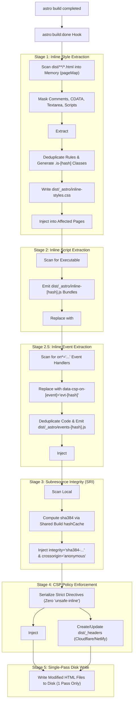

# astro-strict-csp — Architecture & Developer Reference

> Comprehensive documentation detailing all modules, lifecycle stages, edge-case protections, and exact filesystem/HTML side effects.

---

## Table of Contents

1. [Architecture Overview & Pipeline](#1-architecture-overview--pipeline)
2. [File-by-File Technical Reference](#2-file-by-file-technical-reference)
   - [`src/index.ts` (Astro Integration Hook)](#srcindexts)
   - [`src/extractor.ts` (Style & Script Extraction Engine)](#srcextractorts)
   - [`src/events.ts` (Inline Event Extractor & Runtime Dispatcher)](#srceventsts)
   - [`src/html-utils.ts` (Parsing, Masking & Entities)](#srchtml-utilsts)
   - [`src/sri.ts` (Subresource Integrity Engine)](#srcsrits)
   - [`src/csp.ts` (Policy Formatting & Headers)](#srccspts)
   - [`src/crypto.ts` (Cryptographic Hashing Helpers)](#srccryptots)
   - [`src/types.ts` (TypeScript Definitions)](#srctypests)
3. [Filesystem & HTML Side Effects Matrix](#3-filesystem--html-side-effects-matrix)
4. [Edge Case & Security Defenses](#4-edge-case--security-defenses)
5. [Programmatic API Usage](#5-programmatic-api-usage)

---

## 1. Architecture Overview & Pipeline

Modern browser security audits (Mozilla Observatory, Google CSP Evaluator, SOC 2, HIPAA, PCI-DSS) penalize or fail policies containing `'unsafe-inline'`. However, static site generation in Astro frequently emits inline styles (Shiki syntax tokens, component wrappers, SVGs), inline scripts (hydration islands, telemetry), and inline event handlers (`onclick`, `onsubmit`).

`astro-strict-csp` runs purely as a post-build transform during the `astro:build:done` lifecycle hook. It loads pages into memory, transforms all markup in a single pass, emits external bundled assets, computes SRI hashes, and injects strict CSP policies.



---

## 2. File-by-File Technical Reference

### `src/index.ts`
The primary integration entry point connecting `astro-strict-csp` to the Astro engine.

#### Lifecycle Hooks & Behaviors
- **`astro:config:setup`**:
  - **Inspection**: Checks `config.build.inlineStylesheets`.
  - **Side Effect**: Emits a warning through Astro's logger if set to `'always'`. Recommends `'never'` so Astro emits external stylesheets rather than inlining them into `<style>` tags.
- **`astro:build:done`**:
  - **In-Memory Optimization**: Loads all emitted HTML files into memory (`pageMap`) to guarantee each file is read from disk **exactly once** and written back **at most once**.
  - **Pipeline Execution**: Coordinates style extraction, script bundling, SRI hashing, and CSP injection in strict order.

#### Exported Symbols
- `default strictCsp(options?: StrictCspOptions): AstroIntegration`
- Re-exports all utilities, types, and constants from child modules.

---

### `src/extractor.ts`
The core parsing and transformation engine responsible for eliminating inline styles and scripts.

#### Functions
- **`createStyleExtractionState(classPrefix?: string): StyleExtractionState`**:
  - Initializes the shared accumulator tracking deduplicated CSS rules, class mappings, and raw styles across all pages.
  - **Side Effects**: In-memory only.
- **`extractInlineStylesFromHtml(html, state, options): StyleExtractionFileResult`**:
  - Replaces inline `style="..."` attributes with `.is-[hash]` classes.
  - Extracts `<style>` tags into `state.rawStyles` (preserving media queries).
  - **Side Effects**: Mutates `state` in-memory. Returns modified HTML string. Does not perform disk I/O.
- **`extractInlineScriptsFromHtml(html, options, assetsDir): ScriptExtractionFileResult`**:
  - Converts executable inline `<script>` tags into external files (`_astro/inline-[hash].js`).
  - Preserves original execution semantics (classic synchronous vs module).
  - Skips non-executable blocks (`application/ld+json`, `importmap`, templates).
  - **Side Effects**: In-memory string transformation. Returns array of script bundles to be written to disk by the caller.

---

### `src/events.ts`
The inline event handler extraction and runtime dispatcher generation engine.

#### Functions
- **`createEventExtractionState(): EventExtractionState`**:
  - Initializes the shared accumulator tracking deduplicated handler code, generated hash IDs, active event names, and extraction count across all pages.
  - **Side Effects**: In-memory only.
- **`extractInlineEventsFromHtml(html, state, options): EventExtractionFileResult`**:
  - Scans tags for `on*="..."` attributes (`onclick`, `onsubmit`, `onchange`, etc.).
  - Replaces inline event attributes with delegated data attributes (`data-csp-on-[event]="evt-[hash]"`).
  - Decodes HTML entities in handler values so quotes and entities are valid JS statements.
  - Respects `data-preserve` and `data-csp-ignore` attributes to opt out specific elements.
  - **Side Effects**: Mutates `state` in-memory (`state.codeToId`, `state.idToCode`, `state.activeEvents`). Returns modified HTML string. Does not perform disk I/O.
- **`generateEventDispatcherScript(state): string`**:
  - Generates the capturing event delegation script mapping event IDs to executable functions.
  - Attaches listeners to `document` using `{ capture: true }`, ensuring non-bubbling events (`focus`, `blur`, `mouseenter`, `mouseleave`) are intercepted.
  - Binds `this` to the triggering element (`fn.call(el, e)`), passes the `event` object, and cancels default action if the handler returns `false`.

---

### `src/html-utils.ts`
Robust, quote-aware HTML string helpers designed to prevent regex corruption.

#### Functions
- **`decodeHtmlEntities(str: string): string`**:
  - Decodes `&quot;`, `&apos;`, `&#39;`, `&#x27;`, `&#34;`, `&#x22;`, `&lt;`, `&gt;`, `&amp;`.
  - **Why It Matters**: Browsers decode attribute entities before passing styles to the CSS parser. Decoding entities ensures the emitted `.css` stylesheet contains valid CSS declarations instead of raw HTML entities.
- **`maskHtmlRegions(html, options): { masked, unmask }`**:
  - Replaces HTML comments (`<!-- ... -->`), CDATA blocks, `<textarea>` bodies, and (optionally) `<script>` tags with temporary comment placeholders (`<!--__CSP_MASK_0__-->`).
  - **Side Effects**: Prevents regexes from mutating commented-out code, code examples in textareas, or HTML strings inside JS literals.
- **`isExecutableScriptType(typeAttr, ignoreTypes): boolean`**:
  - Implements HTML5 script type matching. Returns `true` for standard JS types (`module`, `text/javascript`, etc.) or missing `type`; returns `false` for structured data or templates.

---

### `src/sri.ts`
Cryptographic Subresource Integrity (SRI) calculator and HTML injector.

#### Functions
- **`injectSriIntoHtml(html, outDir, options, htmlFilePath?, hashCache?): SriResult`**:
  - Scans for local `<script src="...">` and `<link rel="stylesheet">` tags.
  - Computes cryptographic digests (`sha384`, `sha256`, or `sha512`).
  - Injects `integrity="..."` and `crossorigin="anonymous"`.
  - **Side Effects**:
    - **Disk Reads**: Reads referenced local `.js` and `.css` asset files from disk.
    - **In-Memory Cache**: Populates `hashCache` so shared assets (e.g. `inline-styles.css`, `BaseLayout.css`) are read and hashed **only once per build**, regardless of page count.
    - **HTML Mutation**: Injects attributes while preserving self-closing syntax (`/>`).

---

### `src/csp.ts`
Content Security Policy serialization, `<meta>` tag injection, and edge headers generation.

#### Constants & Functions
- **`DEFAULT_STRICT_CSP_DIRECTIVES: CspDirectives`**:
  - Hardened default policy:
    ```http
    default-src 'none';
    script-src 'self';
    style-src 'self';
    img-src 'self' data:;
    font-src 'self';
    connect-src 'self';
    frame-ancestors 'none';
    base-uri 'self';
    form-action 'none';
    upgrade-insecure-requests;
    ```
- **`formatCspDirectives(directives, isMetaTag?): string`**:
  - Serializes directive objects into valid CSP strings.
  - When `isMetaTag: true`, automatically strips `frame-ancestors`, `report-uri`, and `sandbox` (which are disallowed in HTML `<meta>` tags by W3C specification).
- **`injectCspMetaTag(html, cspPolicy): { html, modified }`**:
  - Inserts `<meta http-equiv="Content-Security-Policy">` before `</head>` or updates an existing CSP `<meta>` tag.
  - **Side Effects**: In-memory HTML string transformation.
- **`writeHeadersFile(distDir, cspPolicy, targetFile?): void`**:
  - Updates or creates `dist/_headers` for static hosting providers.
  - **Side Effects**: Writes directly to `dist/_headers` on disk.

---

### `src/crypto.ts`
Fast, zero-dependency hashing built on native `node:crypto`.

#### Functions
- **`computeSriHash(content, algorithm?): string`**: Computes W3C SRI base64 digest (e.g. `sha384-xxxx`).
- **`computeCssClass(styleRule, prefix?): string`**: Computes deterministic 6-character MD5 hash of normalized style rules (e.g. `is-a1b2c3`).
- **`computeContentHash(content, length?): string`**: Computes deterministic SHA-256 slice for naming extracted files.

---

## 3. Filesystem & HTML Side Effects Matrix

| Component | Read Side Effects | Write Side Effects | HTML Mutation Side Effects |
| :--- | :--- | :--- | :--- |
| **`extractStyles`** | None (in-memory) | Creates `dist/_astro/inline-styles.css` if styles extracted | Removes `style="..."` attributes; adds `.is-[hash]` classes; removes extracted `<style>` tags; injects `<link rel="stylesheet">` |
| **`extractScripts`** | None (in-memory) | Creates `dist/_astro/inline-[hash].js` per script | Replaces inline `<script>code</script>` with `<script src="/_astro/inline-[hash].js">` |
| **`extractEvents`** | None (in-memory) | Creates `dist/_astro/events-[hash].js` if handlers extracted | Replaces `on*="..."` attributes with `data-csp-on-[event]="evt-[hash]"`; injects `<script type="module" src="/_astro/events-[hash].js">` |
| **`sri`** | Reads referenced local `.js` & `.css` files from `dist/` | None | Injects `integrity="sha384-..."` and `crossorigin="anonymous"` into `<script src>` and `<link rel="stylesheet">` |
| **`csp (meta)`** | None (in-memory) | None | Injects `<meta http-equiv="Content-Security-Policy">` into `<head>` |
| **`csp (headers)`** | Reads existing `dist/_headers` (if present) | Overwrites or creates `dist/_headers` | None |
| **`build:done` pipeline** | Scans `dist/` and reads all `.html` files **once** | Overwrites modified `.html` files **once** | Coordinates all of the above in memory before writing to disk |

---

## 4. Edge Case & Security Defenses

| Challenge / Edge Case | How `astro-strict-csp` Defends Against It |
| :--- | :--- |
| **`>` character in attribute values** (`aria-label="A > B"`) | Quote-aware tag matching (`TAG_RE`) parses attribute strings as quoted tokens rather than stopping at the first `>` character. |
| **Escaped quotes in styles** (`style="font-family: \"Font\""`) | Attribute matcher supports `(?:[^"\\]|\\.)*`, matching escaped quotes without truncating. |
| **HTML entities in styles & events** (`&quot;`, `&apos;`, `&amp;`) | Decodes entities via `decodeHtmlEntities()` before computing classes, writing CSS, or emitting JS handlers. |
| **Commented-out code** (`<!-- <script>...</script> -->`) | Comments are masked with placeholders before any regex transformations, ensuring inactive markup is untouched. |
| **Literal code in `<textarea>`** | Content inside `<textarea>` blocks is masked with placeholders to preserve code samples. |
| **Inline event handlers in code blocks** (`<code><button onclick="foo()"></code>`) | Script blocks and comments are masked during event extraction so documentation and code samples are never rewritten. |
| **Non-bubbling events** (`focus`, `blur`, `mouseenter`, `mouseleave`) | The event dispatcher listens on `document` with `{ capture: true }`, ensuring non-bubbling events are intercepted during capture phase. |
| **Native event handler semantics** (`this`, `event`, `return false`) | The dispatcher executes `fn.call(el, e)` to bind `this` to the element, passes `e` as `event`, and cancels the default action if `fn` returns `false`. |
| **Media queries on `<style>`** (`media="print"`) | Wraps extracted rules in `@media ${media} { ... }` so print or responsive behavior is preserved in external CSS. |
| **Non-executable scripts** (JSON-LD, `importmap`) | Script extractor checks against HTML5 JavaScript MIME types; structured data and importmaps remain inline. |
| **Synchronous scripts in `<head>`** (Theme toggles) | Preserves classic execution semantics by default (`asModule: false`), preventing Flash of Unstyled Content (FOUC). |
| **Self-closing tags** (`<link ... />`) | SRI regex matches `/\s*\/?>$/` and safely preserves `/>` without emitting stray slashes (`/ integrity=`). |
| **Multi-token `rel` attributes** (`rel="preload stylesheet"`) | Splits space-separated `rel` tokens to identify stylesheets accurately. |
| **Directory traversal in asset URLs** (`../../etc/passwd`) | `resolveAssetPath()` strictly enforces that resolved paths reside inside `dist/`. |
| **Duplicate `<style>` tags across pages** | Accumulates raw styles in a `Set<string>`, emitting shared styles only once in `inline-styles.css`. |
| **Duplicate classes on elements** | Checks existing class lists before appending `.is-[hash]` to prevent duplicate class names. |
| **Opting out specific elements** | Adding `data-preserve` or `data-csp-ignore` to an element skips extraction for styles and event handlers. |
| **Dollar signs in injected strings** (`$1`, `$&`) | All `String.prototype.replace()` calls use replacer functions `() => replacement` to avoid regex replacement token bugs. |

---

## 5. Programmatic API Usage

In addition to the Astro integration default export, all modular transformers and helpers are directly exported for use in custom build scripts, SSR middleware, or test suites:

```typescript
import {
  extractInlineStylesFromHtml,
  extractInlineScriptsFromHtml,
  extractInlineEventsFromHtml,
  generateEventDispatcherScript,
  createEventExtractionState,
  createStyleExtractionState,
  injectSriIntoHtml,
  formatCspDirectives,
  injectCspMetaTag,
  writeHeadersFile,
  computeSriHash,
  computeCssClass,
  computeContentHash,
  decodeHtmlEntities,
  maskHtmlRegions,
  DEFAULT_STRICT_CSP_DIRECTIVES,
} from "astro-strict-csp";

// Example: Manually extract styles, scripts, and event handlers
const styleState = createStyleExtractionState("is-");
const styleResult = extractInlineStylesFromHtml(rawHtml, styleState);

const scriptResult = extractInlineScriptsFromHtml(styleResult.html);

const eventState = createEventExtractionState();
const eventResult = extractInlineEventsFromHtml(scriptResult.html, eventState);
const dispatcherScript = generateEventDispatcherScript(eventState);

// Example: Format custom CSP header
const policy = formatCspDirectives({
  "default-src": ["'self'"],
  "script-src": ["'self'"],
  "style-src": ["'self'"],
});
```
